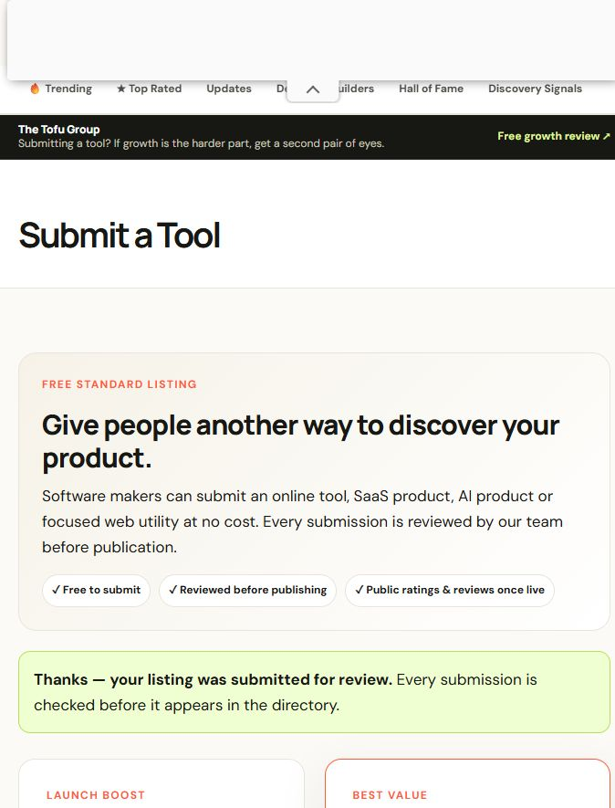
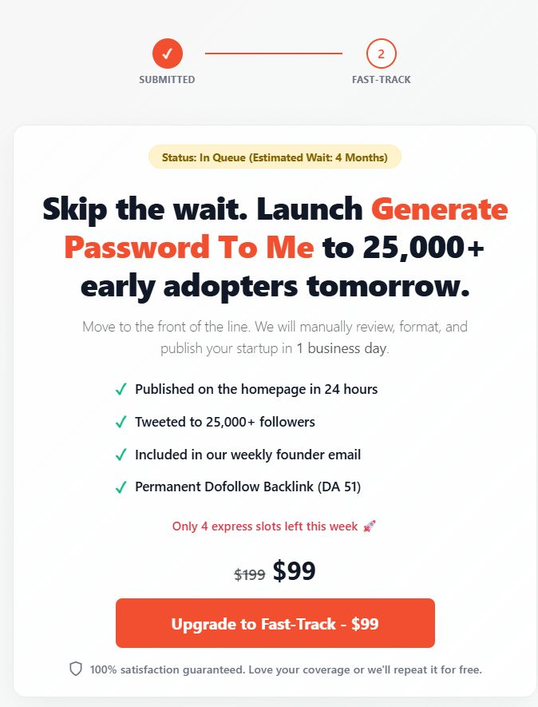

# Case study: promoting generatepasswordto.me

A real, unedited run of the skill against **https://www.generatepasswordto.me/** on **10 November 2026**.

- **Target:** free, client-side password generator (English, 12 languages, NIST 800-63B guidance).
- **Niche:** password generators, cybersecurity utilities, privacy tools.
- **Budget:** 10 attempts.
- **Mode:** live, directory-focused.
- **Contact identity:** `support@generatepasswordto.me` (the site's own published address).

## Result summary

| Outcome | Count |
|---|---|
| Submitted and awaiting review (`pending`) | 2 |
| Failed (donor offline) | 1 |
| Skipped during vetting | 10 |
| Confirmed live links (`success`) | 0 |

No link is reported as live in this case study. Both accepted submissions are in editorial queues, and the skill does not mark a listing as `success` until the published URL returns 2xx with the target link present.

## Submissions

### The Tool Directory — pending

- Submission URL: https://thetooldirectory.com/submit-a-tool/
- Account: not required.
- Category: Utilities.
- Form: tool name, URL, one-line description, pricing, category, contact email, platforms, audience, use cases, alternatives, logo URL, description.
- Response: *"Thanks — your listing was submitted for review. Every submission is checked before it appears in the directory."*
- Link policy (stated by the directory): permanent dofollow link on approved listings.
- Screenshot: [`screenshots/20261110_thetooldirectory.jpeg`](screenshots/20261110_thetooldirectory.jpeg)



### Launching Next — pending

- Submission URL: https://www.launchingnext.com/submit/
- Account: not required; a short arithmetic check gates the form.
- Response: *"Submission Received — Status: In Queue (Estimated Wait: 4 Months)"*.
- Link policy (stated by the directory): permanent dofollow link (DA 51) on publication.
- Upsell: $99 fast-track was offered and **declined**. No payment was made.
- Screenshot: [`screenshots/20261110_launchingnext.jpeg`](screenshots/20261110_launchingnext.jpeg)



## Vetting decisions

| Donor | Score | Decision | Reason |
|---|---|:---:|---|
| thetooldirectory.com | 8 | Submitted | Free, no account, utilities category, permanent dofollow. |
| launchingnext.com | 7 | Submitted | Free queue, startup audience, dofollow. |
| toolsdirectoryonline.com | 7 | Failed | DNS does not resolve; site appears offline despite 2026 roundups. |
| saashub.com | 7 | Deferred | Account needs brand-inbox email verification unavailable to automation. |
| alternativeto.net | 8 | Deferred | Add-app endpoint returns 404; account required. |
| twelve.tools | 6 | Skipped | Free tier requires a reciprocal backlink. |
| fazier.com | 6 | Skipped | Free tier requires a badge/backlink; paid from $39. |
| startups.fm | 6 | Skipped | Paid only: £49 one-off. |
| startupspotlight.co | 5 | Skipped | Paid only: $29 one-off. |
| microlaunch.net | 5 | Skipped | Submit redirects to a paid premium page. |
| toolfolio.com | 6 | Skipped | Submission endpoints return 404. |
| futuretools.io | 3 | Skipped | AI-only directory; not topically relevant. |
| freeaidirectories.com | 3 | Skipped | AI-only directory; not topically relevant. |

Machine-readable records: [`link_building_results.json`](link_building_results.json).

## What the run proved

1. **The vetting gate works.** Eleven of thirteen candidates were rejected before any form was opened, which is the intended behavior: relevance and link policy come first.
2. **No-account directories still exist.** Both accepted submissions needed only a public form and a real contact email. Neither required a disposable inbox, so the temp-mail path stayed idle.
3. **The free-tier landscape is mostly reciprocal or paid.** Six candidates required a backlink badge or a fee. That is a property of the niche's directory market, not a failure of the skill, and it belongs in the log.
4. **Dead and moved endpoints are common.** Three directories from current roundups were unreachable or had 404 submission pages. Discovery must verify endpoints, not trust listicles.
5. **Pending is not success.** Both confirmations are recorded as `pending`; a follow-up run must re-check the published URLs before claiming a backlink.

## Follow-up checklist

- Re-check both submissions after their review windows (24–48 h for The Tool Directory, up to 4 months for Launching Next).
- Update each record to `success` with the live `posted_url` and verified `link_rel` once published.
- Have the site owner register on SaaSHub and AlternativeTo from `support@generatepasswordto.me`, then finish those two listings manually.
- Add niche communities (password-security subreddits, infosec forums) in a separate campaign where self-promotion rules allow it.
- Do not add reciprocal badges for twelve.tools or Fazier unless the operator explicitly approves them.

## Reproduce

```text
Use link-building.
Target URL: https://www.generatepasswordto.me/
Niche: password generators and cybersecurity utilities
Allowed donor types: directory
Max attempts: 10
Desired anchor: free password generator
```
