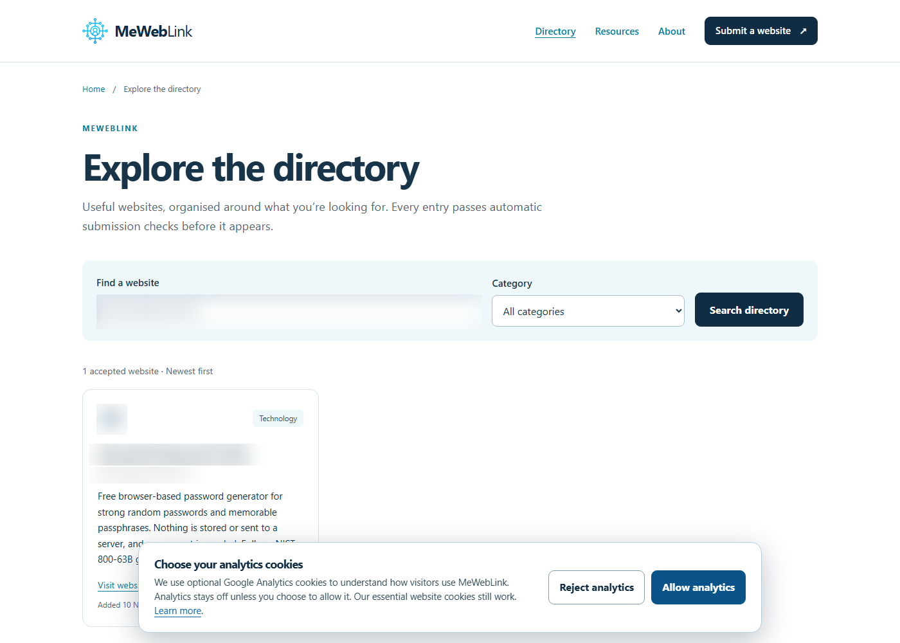
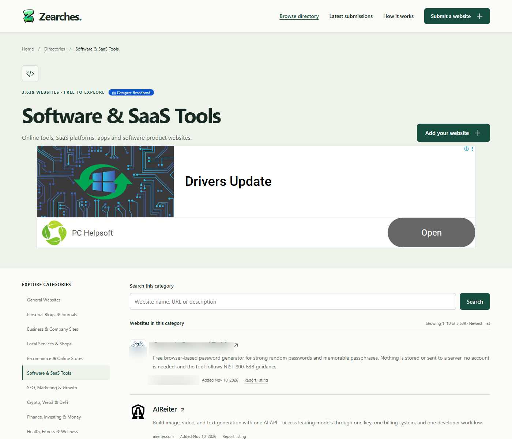
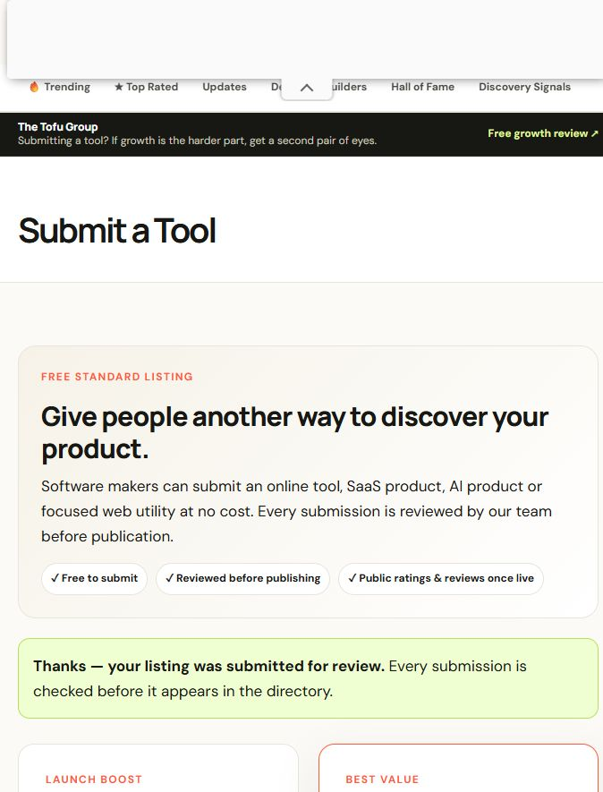
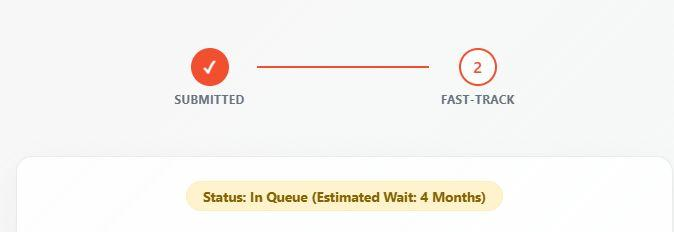

# Case study: a password generator directory campaign

A real, unedited run of the skill on **10 November 2026**. The target site is intentionally anonymized: it is a free, client-side password generator in the password-security niche (12 languages, NIST 800-63B guidance, no account required).

- **Niche:** password generators, cybersecurity utilities, privacy tools.
- **Budget:** 10 attempts; 20 donors investigated in total.
- **Mode:** live, directory-focused.
- **Identity:** a public support address on the target domain was used where a form required one. Names, domains, and logos are redacted in the screenshots.

## Result summary

| Outcome | Count |
|---|---|
| Live and verified (`success`) | 2 |
| Submitted, awaiting review (`pending`) | 5 |
| Skipped during vetting | 11 |
| Failed (endpoint unreachable) | 2 |
| Dofollow links gained | 0 |

Both live links are `rel="ugc nofollow"`. They are real listings with referral and brand value, but the skill does not pretend they pass link equity. No dofollow link can be claimed until a pending listing is published and verified.

## Live listings

### MeWebLink — live, nofollow

- Submission: public form, no account, no payment.
- Response: *"Your website passed the automatic checks and is now in the directory."*
- Link attribute: `rel="ugc nofollow"`.
- Screenshot (site name and search term redacted): [`screenshots/20261110_meweblink.png`](screenshots/20261110_meweblink.png)



### Zearches — live, nofollow

- Submission: public form, no account, no email confirmation.
- Response: *"Your website was saved and added to the directory."*
- Link attribute: `rel="ugc nofollow"`.
- Screenshot (site name and domain redacted): [`screenshots/20261110_zearches.png`](screenshots/20261110_zearches.png)



## Pending submissions

| Directory | Fit | Review window | Notes |
|---|---:|---|---|
| freenosignup.com | 9/10 | 3–5 days | Directory explicitly excludes tools that require registration; ideal fit. Google Form recorded. |
| thewebisfree.com | 8/10 | 1–2 days | Free / open-source / privacy-friendly tools only. Contact Form 7 confirmation received. |
| thetooldirectory.com | 8/10 | 24–48 h | Utilities category, permanent dofollow stated on approval. Site search shows no listing yet. Screenshot: [`screenshots/20261110_thetooldirectory.jpeg`](screenshots/20261110_thetooldirectory.jpeg) |
| launchingnext.com | 7/10 | ~4 months | Free queue; $99 fast-track declined. Dofollow DA 51 on publication. Queue status: [`screenshots/20261110_launchingnext.jpeg`](screenshots/20261110_launchingnext.jpeg) |
| launchpedia.co | 6/10 | Not stated | Elementor form returned "Your submission was successful." No paid promotion purchased. |





## Paid-only and reciprocal traps

These looked free until the submission flow was inspected. None involved a payment.

| Directory | Finding |
|---|---|
| joinly.xyz | Public form looks free; a valid POST returns `303` to a PayProGlobal checkout (product 112614). |
| startups.fm | £49 one-off, no free tier. |
| startupspotlight.co | $29 one-off, live immediately. |
| microlaunch.net | `/submit` redirects to the paid premium page. |
| fazier.com | Free plan requires an embed badge/backlink; paid from $39. |
| twelve.tools | Free listing requires a reciprocal backlink on the target site. |
| toolpilot.ai | Free listing requires a badge; not submitted. |

## CAPTCHA handoffs

Two high-value catalogs stop at human verification. The skill filled the forms and left the tabs open; it did not attempt to bypass the challenge.

| Directory | State |
|---|---|
| saashub.com | Registration filled with a disposable inbox, blocked by a visible hCaptcha. Links reported as nofollow. |
| alternativeto.net | Signup filled, but an invisible hCaptcha keeps "Create account" disabled. |

## Failures

| Directory | Finding |
|---|---|
| toolsdirectoryonline.com | DNS does not resolve; the site is offline despite 2026 roundups. |
| chipjourney.com | `/submit` returns 404; requests are refused (406 / tunnel failure). |
| toolfolio.com | `/submit` and `/submit/new` both render the 404 page. |

## Vetting decisions

| Donor | Score | Decision |
|---|---:|:---:|
| freenosignup.com | 9 | Submitted |
| thewebisfree.com | 8 | Submitted |
| thetooldirectory.com | 8 | Submitted |
| launchingnext.com | 7 | Submitted |
| mewebliink.com | 7 | Submitted — live |
| zearches.com | 6 | Submitted — live |
| launchpedia.co | 6 | Submitted |
| joinly.xyz | 6 | Skipped — paid checkout |
| startups.fm | 6 | Skipped — £49 |
| startupspotlight.co | 5 | Skipped — $29 |
| microlaunch.net | 5 | Skipped — paid |
| twelve.tools | 6 | Skipped — reciprocal link |
| fazier.com | 6 | Skipped — reciprocal link |
| saashub.com | 7 | Deferred — hCaptcha |
| alternativeto.net | 8 | Deferred — hCaptcha |
| toolsdirectoryonline.com | 7 | Failed — offline |
| chipjourney.com | 6 | Failed — dead endpoint |
| toolfolio.com | 6 | Skipped — 404 |
| futuretools.io | 3 | Skipped — AI-only |
| freeaidirectories.com | 3 | Skipped — AI-only |

Machine-readable records: [`link_building_results.json`](link_building_results.json).

## What the run proved

1. **Small, relevant directories still work.** Seven of twenty donors accepted a submission; two published within minutes.
2. **"Free" needs verification.** One form that looked free redirected to a checkout only after a valid POST. Checking the submission result, not the landing page, caught it.
3. **Link attributes matter.** Both instant approvals use `ugc nofollow`. The case study records that explicitly instead of reporting "2 backlinks".
4. **CAPTCHAs are a real boundary.** SaaSHub and AlternativeTo need a human click. The skill left the forms filled and handed off.
5. **Dead endpoints are common.** Three of twenty donors were unreachable or had no working submit page.
6. **The temp-mail path works but is not always the right tool.** A disposable inbox was created for SaaSHub; where a public form accepted the brand address, the brand address was used instead.

## Follow-up checklist

- Re-check the five pending submissions and update each record with the live `posted_url` and verified `link_rel`.
- Solve the SaaSHub and AlternativeTo CAPTCHAs in the open tabs, then finish those listings.
- Explore niche infosec communities only where self-promotion is explicitly allowed.
- Do not add reciprocal badges for twelve.tools, Fazier, or ToolPilot without operator approval.

## Reproduce

```text
Use link-building.
Target URL: https://example.com/password-generator
Niche: password generators and cybersecurity utilities
Allowed donor types: directory
Max attempts: 10
Desired anchor: free password generator
```
